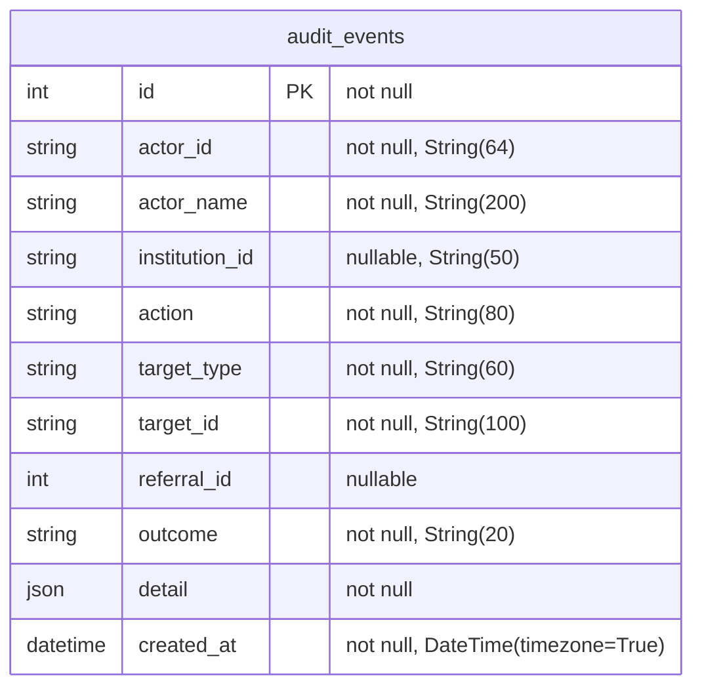
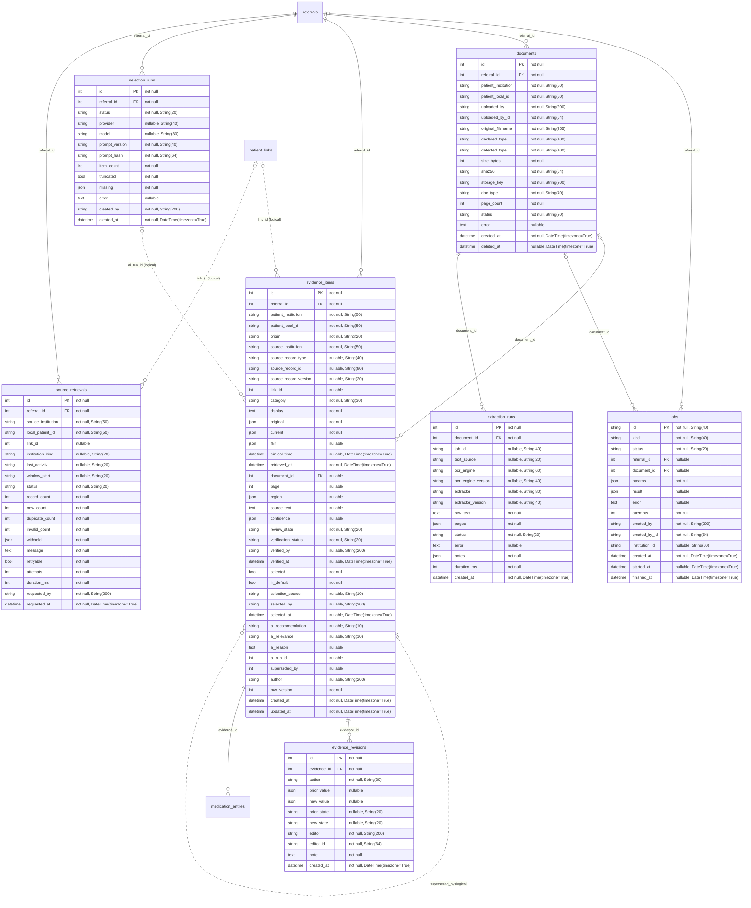
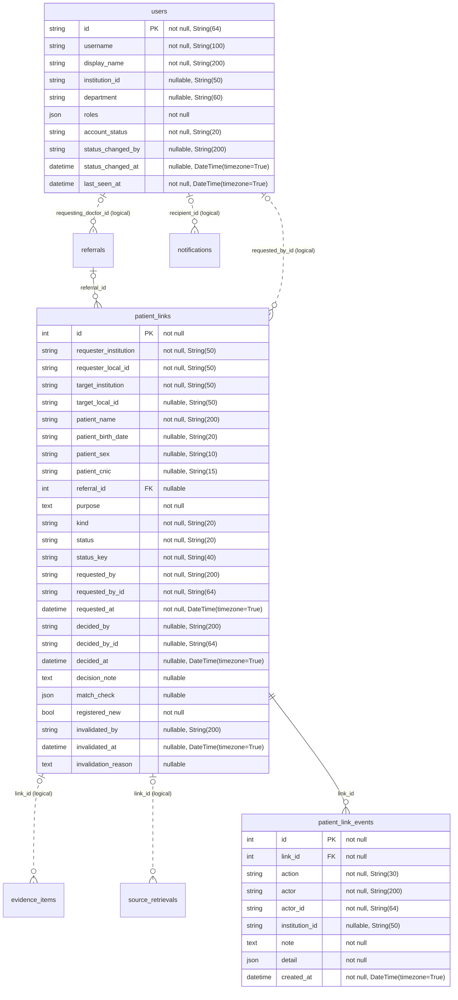

## Central platform database (`central_db`)

Generated from the SQLAlchemy models. Solid lines are database foreign keys; dotted lines are logical references held as plain columns (no constraint). PK primary key, FK foreign key, UK unique.

### Overview: all 34 tables and their relationships

```mermaid
erDiagram
    audit_events {
        int id PK "not null"
    }
    documents {
        int id PK "not null"
    }
    evidence_items {
        int id PK "not null"
    }
    evidence_revisions {
        int id PK "not null"
    }
    extraction_runs {
        int id PK "not null"
    }
    jobs {
        string id PK "not null, String(40)"
    }
    selection_runs {
        int id PK "not null"
    }
    source_retrievals {
        int id PK "not null"
    }
    patient_link_events {
        int id PK "not null"
    }
    patient_links {
        int id PK "not null"
    }
    users {
        string id PK "not null, String(64)"
    }
    ai_suggestions {
        string pair_key PK "not null, String(210)"
    }
    drug_interactions {
        int id PK "not null"
    }
    evaluation_runs {
        int id PK "not null"
    }
    flag_reviews {
        int id PK "not null"
    }
    ingredients {
        string name PK "not null, String(100)"
    }
    label_rules {
        int id PK "not null"
    }
    medication_entries {
        int id PK "not null"
    }
    medication_flags {
        int id PK "not null"
    }
    medication_rules {
        int id PK "not null"
    }
    medicine_names {
        int id PK "not null"
    }
    ruleset_releases {
        int id PK "not null"
    }
    suggestion_reviews {
        int id PK "not null"
    }
    briefs {
        int id PK "not null"
    }
    clarifications {
        int id PK "not null"
    }
    consultation_responses {
        int id PK "not null"
    }
    diagnostic_requests {
        int id PK "not null"
    }
    followup_tasks {
        int id PK "not null"
    }
    inbound_messages {
        int id PK "not null"
    }
    notifications {
        int id PK "not null"
    }
    outbox {
        int id PK "not null"
    }
    referral_events {
        int id PK "not null"
    }
    referral_packages {
        int id PK "not null"
    }
    referrals {
        int id PK "not null"
    }
    ai_suggestions |o..o{ suggestion_reviews : "pair_key (logical)"
    briefs ||--o{ referral_packages : "brief_id"
    documents |o--o{ evidence_items : "document_id"
    documents |o--o{ jobs : "document_id"
    documents ||--o{ extraction_runs : "document_id"
    evaluation_runs ||--o{ medication_flags : "run_id"
    evidence_items |o..o{ evidence_items : "superseded_by (logical)"
    evidence_items ||--o{ evidence_revisions : "evidence_id"
    evidence_items ||--o{ medication_entries : "evidence_id"
    ingredients |o..o{ drug_interactions : "ingredient_a (logical)"
    ingredients |o..o{ drug_interactions : "ingredient_b (logical)"
    ingredients |o..o{ label_rules : "ingredient (logical)"
    ingredients |o..o{ medication_entries : "ingredient (logical)"
    ingredients |o..o{ medicine_names : "ingredient (logical)"
    medication_entries |o..o{ medication_entries : "duplicate_of (logical)"
    medication_entries |o..o{ medication_flags : "medication_entry_id (logical)"
    medication_flags ||--o{ flag_reviews : "flag_id"
    medication_rules |o..o{ medication_flags : "rule_id (logical)"
    patient_links |o..o{ evidence_items : "link_id (logical)"
    patient_links |o..o{ source_retrievals : "link_id (logical)"
    patient_links ||--o{ patient_link_events : "link_id"
    referrals |o--o{ inbound_messages : "referral_id"
    referrals |o--o{ jobs : "referral_id"
    referrals |o--o{ notifications : "referral_id"
    referrals |o--o{ patient_links : "referral_id"
    referrals ||--o{ briefs : "referral_id"
    referrals ||--o{ clarifications : "referral_id"
    referrals ||--o{ consultation_responses : "referral_id"
    referrals ||--o{ diagnostic_requests : "referral_id"
    referrals ||--o{ documents : "referral_id"
    referrals ||--o{ evaluation_runs : "referral_id"
    referrals ||--o{ evidence_items : "referral_id"
    referrals ||--o{ flag_reviews : "referral_id"
    referrals ||--o{ followup_tasks : "referral_id"
    referrals ||--o{ medication_entries : "referral_id"
    referrals ||--o{ medication_flags : "referral_id"
    referrals ||--o{ outbox : "referral_id"
    referrals ||--o{ referral_events : "referral_id"
    referrals ||--o{ referral_packages : "referral_id"
    referrals ||--o{ selection_runs : "referral_id"
    referrals ||--o{ source_retrievals : "referral_id"
    referrals ||--o{ suggestion_reviews : "referral_id"
    selection_runs |o..o{ evidence_items : "ai_run_id (logical)"
    users |o..o{ notifications : "recipient_id (logical)"
    users |o..o{ patient_links : "requested_by_id (logical)"
    users |o..o{ referrals : "requesting_doctor_id (logical)"
```

### ERD: `audit` domain (1 tables, `services/central/app/models/audit.py`)

### ERD: `evidence` domain (7 tables, `services/central/app/models/evidence.py`)

### ERD: `identity` domain (3 tables, `services/central/app/models/identity.py`)

### ERD: `medications` domain (12 tables, `services/central/app/models/medications.py`)

```mermaid
erDiagram
    ai_suggestions {
        string pair_key PK "not null, String(210)"
        string ingredient_a "not null, String(100)"
        string ingredient_b "not null, String(100)"
        float score "not null"
        text reason "not null"
        string model_version "not null, String(60)"
        string data_version "not null, String(200)"
    }
    drug_interactions {
        int id PK "not null"
        string ingredient_a "not null, String(100)"
        string ingredient_b "not null, String(100)"
        string severity "not null, String(20)"
        string source "not null, String(40)"
        string source_version "not null, String(80)"
        string source_ref "not null, String(80)"
        text label_quote "nullable"
        string label_source "nullable, String(200)"
        string label_section "nullable, String(60)"
    }
    evaluation_runs {
        int id PK "not null"
        int referral_id FK "not null"
        string trigger "not null, String(160)"
        string status "not null, String(20)"
        string outcome "nullable, String(30)"
        text summary_message "nullable"
        json context "not null"
        json rule_versions "not null"
        string input_hash "not null, String(64)"
        string ruleset_hash "nullable, String(64)"
        text error "nullable"
        int changed_flags "not null"
        string triggered_by "not null, String(200)"
        datetime created_at "not null, DateTime(timezone=True)"
    }
    flag_reviews {
        int id PK "not null"
        int referral_id FK "not null"
        int flag_id FK "not null"
        int flag_version "not null"
        string side "not null, String(20)"
        string reviewer "not null, String(200)"
        string reviewer_id "not null, String(64)"
        string institution_id "not null, String(50)"
        int package_version "nullable"
        string decision "not null, String(20)"
        string ruleset_hash "nullable, String(64)"
        text note "not null"
        datetime created_at "not null, DateTime(timezone=True)"
    }
    ingredients {
        string name PK "not null, String(100)"
        string standard "nullable, String(100)"
        string label_name "nullable, String(100)"
        string rxnorm_id "nullable, String(20)"
        json atc_codes "not null"
        json components "not null"
        bool in_interaction_source "not null"
        text note "nullable"
    }
    label_rules {
        int id PK "not null"
        string rule_key UK "not null, String(200)"
        string kind "not null, String(20)"
        string ingredient "not null, String(100)"
        string target "not null, String(60)"
        string target_label "not null, String(120)"
        string severity_hint "not null, String(20)"
        text summary "not null"
        text quote "not null"
        string section "not null, String(40)"
        string source_type "not null, String(40)"
        string source_ref "not null, String(80)"
        string source_name "not null, String(200)"
        string source_version "not null, String(80)"
        string extractor_version "not null, String(40)"
        string status "not null, String(20)"
    }
    medication_entries {
        int id PK "not null"
        int referral_id FK "not null"
        int evidence_id FK "not null"
        string record_kind "not null, String(20)"
        string original_name "not null, String(200)"
        string brand "nullable, String(100)"
        string strength "nullable, String(60)"
        string dose "nullable, String(120)"
        string route "nullable, String(40)"
        string frequency "nullable, String(100)"
        string start_date "nullable, String(20)"
        bool over_the_counter "not null"
        string source_label "not null, String(300)"
        string ingredient "nullable, String(100)"
        json ingredients "not null"
        string drug_class "nullable, String(60)"
        string mapping_status "not null, String(20)"
        json mapping_choices "nullable"
        text mapping_note "nullable"
        int duplicate_of "nullable"
        bool dose_differs "not null"
        bool excluded "not null"
        string excluded_by "nullable, String(200)"
        text excluded_reason "nullable"
        datetime created_at "not null, DateTime(timezone=True)"
        datetime updated_at "not null, DateTime(timezone=True)"
    }
    medication_flags {
        int id PK "not null"
        int referral_id FK "not null"
        string flag_key "not null, String(200)"
        int version "not null"
        string kind "not null, String(40)"
        string severity "nullable, String(20)"
        json ingredients "not null"
        string source_type "nullable, String(40)"
        string source_name "nullable, String(200)"
        text source_ref "nullable"
        string source_version "nullable, String(80)"
        text source_quote "nullable"
        bool auto_generated "not null"
        bool requires_decision "not null"
        string title "not null, String(300)"
        text message "not null"
        string medication "nullable, String(300)"
        string drug_class "nullable, String(60)"
        string source_label "nullable, String(500)"
        string rule_id "nullable, String(60)"
        int rule_version "nullable"
        int medication_entry_id "nullable"
        json evidence_ids "not null"
        string content_hash "not null, String(64)"
        string status "not null, String(20)"
        int run_id FK "not null"
        datetime created_at "not null, DateTime(timezone=True)"
        datetime superseded_at "nullable, DateTime(timezone=True)"
    }
    medication_rules {
        int id PK "not null"
        string rule_id "not null, String(60)"
        int version "not null"
        string title "not null, String(300)"
        string drug_class "not null, String(60)"
        json procedure_tags "not null"
        text message "not null"
        text rationale "not null"
        text reference "not null"
        string status "not null, String(20)"
        string content_hash "not null, String(64)"
        string created_by "not null, String(200)"
        string created_by_id "not null, String(64)"
        datetime created_at "not null, DateTime(timezone=True)"
        string decided_by "nullable, String(200)"
        string decided_by_id "nullable, String(64)"
        datetime decided_at "nullable, DateTime(timezone=True)"
        text reference_checked "nullable"
        text decision_note "nullable"
    }
    medicine_names {
        int id PK "not null"
        string name UK "not null, String(120)"
        string display "not null, String(120)"
        string ingredient "not null, String(100)"
        string drug_class "not null, String(60)"
        string kind "not null, String(20)"
        string status "not null, String(20)"
        json options "nullable"
        string added_by "not null, String(200)"
        datetime created_at "not null, DateTime(timezone=True)"
    }
    ruleset_releases {
        int id PK "not null"
        string hash UK "not null, String(64)"
        text notes "not null"
        json counts "not null"
        datetime created_at "not null, DateTime(timezone=True)"
    }
    suggestion_reviews {
        int id PK "not null"
        int referral_id FK "not null"
        string pair_key "not null, String(210)"
        string decision "not null, String(20)"
        text note "not null"
        float score "not null"
        string model_version "not null, String(60)"
        string data_version "not null, String(200)"
        string reviewer "not null, String(200)"
        string reviewer_id "not null, String(64)"
        datetime created_at "not null, DateTime(timezone=True)"
    }
    ai_suggestions |o..o{ suggestion_reviews : "pair_key (logical)"
    evaluation_runs ||--o{ medication_flags : "run_id"
    evidence_items ||--o{ medication_entries : "evidence_id"
    ingredients |o..o{ drug_interactions : "ingredient_a (logical)"
    ingredients |o..o{ drug_interactions : "ingredient_b (logical)"
    ingredients |o..o{ label_rules : "ingredient (logical)"
    ingredients |o..o{ medication_entries : "ingredient (logical)"
    ingredients |o..o{ medicine_names : "ingredient (logical)"
    medication_entries |o..o{ medication_entries : "duplicate_of (logical)"
    medication_entries |o..o{ medication_flags : "medication_entry_id (logical)"
    medication_flags ||--o{ flag_reviews : "flag_id"
    medication_rules |o..o{ medication_flags : "rule_id (logical)"
    referrals ||--o{ evaluation_runs : "referral_id"
    referrals ||--o{ flag_reviews : "referral_id"
    referrals ||--o{ medication_entries : "referral_id"
    referrals ||--o{ medication_flags : "referral_id"
    referrals ||--o{ suggestion_reviews : "referral_id"
```

### ERD: `referrals` domain (11 tables, `services/central/app/models/referrals.py`)

```mermaid
erDiagram
    briefs {
        int id PK "not null"
        int referral_id FK "not null"
        int version "not null"
        string kind "not null, String(20)"
        json sections "not null"
        json limitations "not null"
        json evidence_ids "not null"
        string created_by "not null, String(200)"
        datetime created_at "not null, DateTime(timezone=True)"
    }
    clarifications {
        int id PK "not null"
        int referral_id FK "not null"
        int provider_clarification_id "nullable"
        int package_version "nullable"
        text question "not null"
        string asked_by "not null, String(200)"
        datetime asked_at "not null, DateTime(timezone=True)"
        string status "not null, String(20)"
        text answer "nullable"
        string answered_by "nullable, String(200)"
        datetime answered_at "nullable, DateTime(timezone=True)"
    }
    consultation_responses {
        int id PK "not null"
        int referral_id FK "not null"
        string remote_key UK "not null, String(200)"
        int package_version "not null"
        json content "not null"
        string specialist_name "not null, String(200)"
        datetime returned_at "not null, DateTime(timezone=True)"
        datetime received_at "not null, DateTime(timezone=True)"
        string reviewed_by "nullable, String(200)"
        string reviewed_by_id "nullable, String(64)"
        datetime reviewed_at "nullable, DateTime(timezone=True)"
        text review_note "nullable"
        json fhir_task "nullable"
    }
    diagnostic_requests {
        int id PK "not null"
        string reference UK "not null, String(30)"
        int referral_id FK "not null"
        string category "not null, String(20)"
        string test "not null, String(200)"
        string body_area "nullable, String(100)"
        text clinical_question "not null"
        string urgency "not null, String(20)"
        string destination_institution "not null, String(50)"
        string destination_department "not null, String(60)"
        string status "not null, String(20)"
        string requested_by "not null, String(200)"
        string requested_by_id "not null, String(64)"
        string sent_by "nullable, String(200)"
        datetime sent_at "nullable, DateTime(timezone=True)"
        text reject_reason "nullable"
        datetime scheduled_for "nullable, DateTime(timezone=True)"
        json report "nullable"
        json attachments "not null"
        string local_patient_id "nullable, String(50)"
        string seen_by "nullable, String(200)"
        datetime seen_at "nullable, DateTime(timezone=True)"
        json history "not null"
        datetime created_at "not null, DateTime(timezone=True)"
        datetime updated_at "not null, DateTime(timezone=True)"
    }
    followup_tasks {
        int id PK "not null"
        int referral_id FK "not null"
        text description "not null"
        string specified_by "not null, String(200)"
        string assignee_name "nullable, String(200)"
        date due_date "nullable"
        string status "not null, String(20)"
        text outcome "nullable"
        string completed_by "nullable, String(200)"
        datetime completed_at "nullable, DateTime(timezone=True)"
        string created_by "not null, String(200)"
        datetime created_at "not null, DateTime(timezone=True)"
    }
    inbound_messages {
        int id PK "not null"
        string message_key UK "not null, String(200)"
        string message_type "not null, String(40)"
        int referral_id FK "nullable"
        json payload "not null"
        datetime received_at "not null, DateTime(timezone=True)"
    }
    notifications {
        int id PK "not null"
        string recipient_id "nullable, String(64)"
        string institution_id "not null, String(50)"
        string role "nullable, String(40)"
        int referral_id FK "nullable"
        string kind "not null, String(40)"
        string title "not null, String(300)"
        text body "not null"
        string link "nullable, String(200)"
        datetime created_at "not null, DateTime(timezone=True)"
        datetime read_at "nullable, DateTime(timezone=True)"
        string read_by "nullable, String(200)"
    }
    outbox {
        int id PK "not null"
        int referral_id FK "not null"
        string kind "not null, String(40)"
        string target_institution "not null, String(50)"
        string message_key UK "not null, String(200)"
        json payload "not null"
        string status "not null, String(20)"
        int attempts "not null"
        text last_error "nullable"
        datetime next_attempt_at "not null, DateTime(timezone=True)"
        datetime created_at "not null, DateTime(timezone=True)"
        datetime sent_at "nullable, DateTime(timezone=True)"
        json remote_result "nullable"
    }
    referral_events {
        int id PK "not null"
        int referral_id FK "not null"
        string event_type "not null, String(50)"
        string from_status "nullable, String(30)"
        string to_status "nullable, String(30)"
        string actor "not null, String(200)"
        string institution_id "nullable, String(50)"
        json detail "not null"
        datetime created_at "not null, DateTime(timezone=True)"
    }
    referral_packages {
        int id PK "not null"
        int referral_id FK "not null"
        int version "not null"
        int brief_id FK "not null"
        json envelope "not null"
        string content_hash "not null, String(64)"
        string delivery_key UK "not null, String(200)"
        string sent_by "not null, String(200)"
        string sent_by_id "not null, String(64)"
        datetime sent_at "not null, DateTime(timezone=True)"
        bool superseded "not null"
        json manifest "nullable"
        datetime content_purged_at "nullable, DateTime(timezone=True)"
    }
    referrals {
        int id PK "not null"
        string reference UK "not null, String(30)"
        string patient_institution "not null, String(50)"
        string patient_local_id "not null, String(50)"
        string patient_name "not null, String(200)"
        string patient_birth_date "nullable, String(20)"
        string patient_sex "nullable, String(10)"
        string patient_cnic "nullable, String(15)"
        string source_institution "not null, String(50)"
        string source_department "nullable, String(60)"
        string requesting_doctor_id "nullable, String(64)"
        string requesting_doctor_name "not null, String(200)"
        string created_by_id "not null, String(64)"
        string created_by_name "not null, String(200)"
        string kind "not null, String(20)"
        string destination_institution "nullable, String(50)"
        string destination_department "nullable, String(60)"
        string destination_doctor "nullable, String(200)"
        text reason "not null"
        text consultation_notes "not null"
        string urgency "not null, String(20)"
        string procedure_status "not null, String(20)"
        string planned_procedure "nullable, String(300)"
        json procedure_tags "not null"
        string status "not null, String(30)"
        int row_version "not null"
        datetime requested_at "nullable, DateTime(timezone=True)"
        string prepared_by "nullable, String(200)"
        datetime prepared_at "nullable, DateTime(timezone=True)"
        string packet_reviewed_by "nullable, String(200)"
        datetime packet_reviewed_at "nullable, DateTime(timezone=True)"
        bool amendment_open "not null"
        int current_package_version "nullable"
        int submitted_package_version "nullable"
        string delivery_status "not null, String(20)"
        string meds_checked_by "nullable, String(200)"
        datetime meds_checked_at "nullable, DateTime(timezone=True)"
        text meds_checked_note "nullable"
        string patient_informed_by "nullable, String(200)"
        datetime patient_informed_at "nullable, DateTime(timezone=True)"
        text patient_informed_note "nullable"
        text cancel_reason "nullable"
        text decline_reason "nullable"
        datetime closed_at "nullable, DateTime(timezone=True)"
        string closed_by "nullable, String(200)"
        datetime acknowledged_at "nullable, DateTime(timezone=True)"
        datetime accepted_at "nullable, DateTime(timezone=True)"
        datetime working_set_expires_at "nullable, DateTime(timezone=True)"
        datetime working_set_purged_at "nullable, DateTime(timezone=True)"
        datetime receiver_completed_at "nullable, DateTime(timezone=True)"
        string receiver_completed_by "nullable, String(200)"
        datetime created_at "not null, DateTime(timezone=True)"
        datetime updated_at "not null, DateTime(timezone=True)"
    }
    briefs ||--o{ referral_packages : "brief_id"
    referrals |o--o{ inbound_messages : "referral_id"
    referrals |o--o{ jobs : "referral_id"
    referrals |o--o{ notifications : "referral_id"
    referrals |o--o{ patient_links : "referral_id"
    referrals ||--o{ briefs : "referral_id"
    referrals ||--o{ clarifications : "referral_id"
    referrals ||--o{ consultation_responses : "referral_id"
    referrals ||--o{ diagnostic_requests : "referral_id"
    referrals ||--o{ documents : "referral_id"
    referrals ||--o{ evaluation_runs : "referral_id"
    referrals ||--o{ evidence_items : "referral_id"
    referrals ||--o{ flag_reviews : "referral_id"
    referrals ||--o{ followup_tasks : "referral_id"
    referrals ||--o{ medication_entries : "referral_id"
    referrals ||--o{ medication_flags : "referral_id"
    referrals ||--o{ outbox : "referral_id"
    referrals ||--o{ referral_events : "referral_id"
    referrals ||--o{ referral_packages : "referral_id"
    referrals ||--o{ selection_runs : "referral_id"
    referrals ||--o{ source_retrievals : "referral_id"
    referrals ||--o{ suggestion_reviews : "referral_id"
    users |o..o{ notifications : "recipient_id (logical)"
    users |o..o{ referrals : "requesting_doctor_id (logical)"
```

