## Institution service database (one per institution: `drali_db`, `chughtai_db`, `ziauddin_db`, `akuh_db`)

Generated from the SQLAlchemy models. Solid lines are database foreign keys; dotted lines are logical references held as plain columns (no constraint). PK primary key, FK foreign key, UK unique.

### Overview: all 22 tables and their relationships

```mermaid
erDiagram
    audit_events {
        int id PK "not null"
    }
    cases {
        int id PK "not null"
    }
    conditions {
        string id PK "not null, String(40)"
    }
    consultation_responses {
        int id PK "not null"
    }
    doctor_keys {
        int id PK "not null"
    }
    forwarded_results {
        int id PK "not null"
    }
    group_key_wraps {
        int id PK "not null"
    }
    imaging_reports {
        string id PK "not null, String(40)"
    }
    incoming_packages {
        int id PK "not null"
    }
    info_requests {
        int id PK "not null"
    }
    key_store {
        int id PK "not null"
    }
    lab_results {
        string id PK "not null, String(40)"
    }
    medications {
        string id PK "not null, String(40)"
    }
    order_attachments {
        int id PK "not null"
    }
    orders {
        int id PK "not null"
    }
    outbox {
        int id PK "not null"
    }
    patients {
        string local_id PK "not null, String(30)"
    }
    record_requests {
        int id PK "not null"
    }
    seen_assertions {
        string jti PK "not null, String(80)"
    }
    sent_copies {
        int id PK "not null"
    }
    surgeries {
        string id PK "not null, String(40)"
    }
    visits {
        string id PK "not null, String(40)"
    }
    cases |o--o{ outbox : "case_id"
    cases ||--o{ consultation_responses : "case_id"
    cases ||--o{ forwarded_results : "case_id"
    cases ||--o{ incoming_packages : "case_id"
    cases ||--o{ info_requests : "case_id"
    orders |o--o{ outbox : "order_id"
    orders ||--o{ order_attachments : "order_id"
    patients |o..o{ cases : "local_patient_id (logical)"
    patients |o..o{ orders : "local_patient_id (logical)"
    patients ||--o{ conditions : "patient_id"
    patients ||--o{ imaging_reports : "patient_id"
    patients ||--o{ lab_results : "patient_id"
    patients ||--o{ medications : "patient_id"
    patients ||--o{ surgeries : "patient_id"
    patients ||--o{ visits : "patient_id"
```

### ERD with all columns

```mermaid
erDiagram
    audit_events {
        int id PK "not null"
        string actor_id "not null, String(100)"
        string actor_name "not null, String(200)"
        string institution_id "nullable, String(50)"
        string action "not null, String(100)"
        string target_type "not null, String(60)"
        string target_id "not null, String(100)"
        string outcome "not null, String(20)"
        string referral_context "nullable, String(60)"
        json detail "not null"
        datetime created_at "not null, DateTime(timezone=True)"
    }
    cases {
        int id PK "not null"
        string central_referral_id UK "not null, String(40)"
        string sender_institution "not null, String(50)"
        string sender_name "not null, String(200)"
        string department "not null, String(60)"
        string requested_doctor "nullable, String(200)"
        string patient_name "not null, String(200)"
        string patient_birth_date "nullable, String(20)"
        string patient_sex "nullable, String(10)"
        string patient_cnic "nullable, String(15)"
        string local_patient_id "nullable, String(30)"
        int link_request_id "nullable"
        string urgency "not null, String(20)"
        string status "not null, String(30)"
        int latest_version "not null"
        string assigned_doctor "nullable, String(200)"
        string assigned_by "nullable, String(200)"
        datetime assigned_at "nullable, DateTime(timezone=True)"
        text assign_note "nullable"
        string acknowledged_by "nullable, String(200)"
        datetime acknowledged_at "nullable, DateTime(timezone=True)"
        string decision "nullable, String(20)"
        string decision_by "nullable, String(200)"
        datetime decision_at "nullable, DateTime(timezone=True)"
        text decline_reason "nullable"
        string completed_by "nullable, String(200)"
        datetime completed_at "nullable, DateTime(timezone=True)"
        datetime hold_until "nullable, DateTime(timezone=True)"
        datetime shared_removed_at "nullable, DateTime(timezone=True)"
        datetime received_at "not null, DateTime(timezone=True)"
        datetime updated_at "not null, DateTime(timezone=True)"
    }
    conditions {
        string id PK "not null, String(40)"
        string patient_id FK "not null"
        string display "not null, String(300)"
        string snomed "nullable, String(30)"
        string clinical_status "not null, String(20)"
        string onset "nullable, String(10)"
        string sensitive_category "nullable, String(40)"
        int version "not null"
        datetime updated_at "not null, DateTime(timezone=True)"
    }
    consultation_responses {
        int id PK "not null"
        int case_id FK "not null"
        int package_version "not null"
        json content "not null"
        string status "not null, String(20)"
        string drafted_by "not null, String(200)"
        datetime drafted_at "not null, DateTime(timezone=True)"
        int row_version "not null"
        string returned_by "nullable, String(200)"
        string returned_by_id "nullable, String(100)"
        datetime returned_at "nullable, DateTime(timezone=True)"
        string return_key UK "nullable, String(200)"
    }
    doctor_keys {
        int id PK "not null"
        string subject_id "not null, String(64)"
        string username "not null, String(100)"
        string display_name "not null, String(200)"
        string department "nullable, String(60)"
        string enc_key_id "not null, String(16)"
        int key_version "not null"
        json request "not null"
        json entry "nullable"
        string status "not null, String(20)"
        bool recovery "not null"
        string approved_by "nullable, String(200)"
        json revocation "nullable"
        string revoked_by "nullable, String(200)"
        datetime revoked_at "nullable, DateTime(timezone=True)"
        datetime published_at "nullable, DateTime(timezone=True)"
        datetime created_at "not null, DateTime(timezone=True)"
    }
    forwarded_results {
        int id PK "not null"
        string forward_key UK "not null, String(200)"
        int case_id FK "not null"
        json content "not null"
        datetime received_at "not null, DateTime(timezone=True)"
    }
    group_key_wraps {
        int id PK "not null"
        string department "not null, String(60)"
        int group_version "not null"
        string member_subject_id "not null, String(64)"
        string member_key_id "not null, String(16)"
        json wrapped "not null"
        datetime published_at "nullable, DateTime(timezone=True)"
        datetime created_at "not null, DateTime(timezone=True)"
    }
    imaging_reports {
        string id PK "not null, String(40)"
        string patient_id FK "not null"
        date study_date "not null"
        string study "not null, String(200)"
        string body_part "nullable, String(100)"
        text findings "not null"
        text impression "not null"
        string reporter "nullable, String(200)"
        string sensitive_category "nullable, String(40)"
        int version "not null"
        datetime updated_at "not null, DateTime(timezone=True)"
    }
    incoming_packages {
        int id PK "not null"
        int case_id FK "not null"
        int version "not null"
        string delivery_key UK "not null, String(200)"
        json envelope "not null"
        string content_hash "not null, String(64)"
        datetime received_at "not null, DateTime(timezone=True)"
    }
    info_requests {
        int id PK "not null"
        int case_id FK "not null"
        int package_version "not null"
        text question "not null"
        string status "not null, String(20)"
        string created_by "not null, String(200)"
        datetime created_at "not null, DateTime(timezone=True)"
        text answer "nullable"
        string answered_by "nullable, String(200)"
        datetime answered_at "nullable, DateTime(timezone=True)"
        string answer_key UK "nullable, String(200)"
    }
    key_store {
        int id PK "not null"
        string purpose "not null, String(80)"
        int version "not null"
        text public_spki "not null"
        json private_sealed "not null"
        json entry "nullable"
        datetime published_at "nullable, DateTime(timezone=True)"
        datetime created_at "not null, DateTime(timezone=True)"
        datetime retired_at "nullable, DateTime(timezone=True)"
    }
    lab_results {
        string id PK "not null, String(40)"
        string patient_id FK "not null"
        string panel "not null, String(200)"
        date collected "not null"
        string test "not null, String(120)"
        string loinc "nullable, String(20)"
        float value_num "nullable"
        string value_text "nullable, String(200)"
        string unit "nullable, String(40)"
        string reference_range "nullable, String(60)"
        string abnormal_flag "nullable, String(20)"
        string sensitive_category "nullable, String(40)"
        string status "not null, String(20)"
        text note "nullable"
        int version "not null"
        datetime updated_at "not null, DateTime(timezone=True)"
    }
    medications {
        string id PK "not null, String(40)"
        string patient_id FK "not null"
        string name "not null, String(200)"
        string brand_as_written "nullable, String(100)"
        string dose "nullable, String(100)"
        string route "nullable, String(40)"
        string frequency "nullable, String(100)"
        date start_date "nullable"
        string status "not null, String(20)"
        string prescriber "nullable, String(200)"
        text note "nullable"
        string sensitive_category "nullable, String(40)"
        int version "not null"
        datetime updated_at "not null, DateTime(timezone=True)"
    }
    order_attachments {
        int id PK "not null"
        int order_id FK "not null"
        string filename "not null, String(200)"
        string content_type "not null, String(100)"
        bytes data "not null"
        string uploaded_by "not null, String(200)"
        datetime created_at "not null, DateTime(timezone=True)"
    }
    orders {
        int id PK "not null"
        string order_key UK "not null, String(200)"
        string order_ref "not null, String(40)"
        string central_referral_id "not null, String(40)"
        string sender_institution "not null, String(50)"
        string sender_name "not null, String(200)"
        string department "not null, String(60)"
        string category "not null, String(20)"
        string test "not null, String(200)"
        string body_area "nullable, String(100)"
        text clinical_question "not null"
        string urgency "not null, String(20)"
        string patient_name "not null, String(200)"
        string patient_birth_date "nullable, String(20)"
        string patient_sex "nullable, String(10)"
        string patient_cnic "nullable, String(15)"
        string local_patient_id "nullable, String(30)"
        int link_request_id "nullable"
        string requested_by "not null, String(200)"
        string status "not null, String(20)"
        text reject_reason "nullable"
        datetime scheduled_for "nullable, DateTime(timezone=True)"
        text report_text "nullable"
        text findings "nullable"
        text impression "nullable"
        json values "not null"
        string reported_by "nullable, String(200)"
        datetime reported_at "nullable, DateTime(timezone=True)"
        json history "not null"
        datetime received_at "not null, DateTime(timezone=True)"
        datetime updated_at "not null, DateTime(timezone=True)"
    }
    outbox {
        int id PK "not null"
        string event_key UK "not null, String(200)"
        string event_type "not null, String(40)"
        int case_id FK "nullable"
        int order_id FK "nullable"
        json payload "not null"
        string status "not null, String(20)"
        int attempts "not null"
        text last_error "nullable"
        datetime next_attempt_at "not null, DateTime(timezone=True)"
        datetime created_at "not null, DateTime(timezone=True)"
        datetime sent_at "nullable, DateTime(timezone=True)"
    }
    patients {
        string local_id PK "not null, String(30)"
        string cnic "nullable, String(15)"
        string given "not null, String(100)"
        string family "not null, String(100)"
        date birth_date "not null"
        string sex "not null, String(10)"
        string phone "nullable, String(30)"
        string city "nullable, String(60)"
        string registered_by "nullable, String(200)"
        bool synthetic "not null"
        int version "not null"
        datetime updated_at "not null, DateTime(timezone=True)"
    }
    record_requests {
        int id PK "not null"
        string request_key UK "not null, String(200)"
        string referral_ref "not null, String(40)"
        string requesting_org "not null, String(50)"
        string practitioner_id "not null, String(64)"
        string practitioner_name "nullable, String(200)"
        string purpose "not null, String(20)"
        string consent_ref "not null, String(60)"
        string local_patient_id "nullable, String(50)"
        json categories "not null"
        string since "nullable, String(20)"
        text reason_text "nullable"
        json sensitive "not null"
        json practitioner_entry "nullable"
        json patient_entry "nullable"
        string status "not null, String(30)"
        json refusals "not null"
        string policy_version "not null, String(40)"
        int item_count "not null"
        string decided_by "nullable, String(200)"
        datetime decided_at "nullable, DateTime(timezone=True)"
        datetime delivered_at "nullable, DateTime(timezone=True)"
        text delivery_error "nullable"
        datetime created_at "not null, DateTime(timezone=True)"
    }
    seen_assertions {
        string jti PK "not null, String(80)"
        string issuer "not null, String(50)"
        datetime expires_at "not null, DateTime(timezone=True)"
    }
    sent_copies {
        int id PK "not null"
        string copy_key UK "not null, String(220)"
        string central_referral_id "not null, String(40)"
        string kind "not null, String(20)"
        int version "not null"
        json content "not null"
        datetime received_at "not null, DateTime(timezone=True)"
    }
    surgeries {
        string id PK "not null, String(40)"
        string patient_id FK "not null"
        string procedure "not null, String(300)"
        string performed "nullable, String(10)"
        string location "nullable, String(200)"
        int version "not null"
        datetime updated_at "not null, DateTime(timezone=True)"
    }
    visits {
        string id PK "not null, String(40)"
        string patient_id FK "not null"
        date visit_date "not null"
        string setting "not null, String(200)"
        string clinician "nullable, String(200)"
        text reason "not null"
        text summary "not null"
        string sensitive_category "nullable, String(40)"
        int version "not null"
        datetime updated_at "not null, DateTime(timezone=True)"
    }
    cases |o--o{ outbox : "case_id"
    cases ||--o{ consultation_responses : "case_id"
    cases ||--o{ forwarded_results : "case_id"
    cases ||--o{ incoming_packages : "case_id"
    cases ||--o{ info_requests : "case_id"
    orders |o--o{ outbox : "order_id"
    orders ||--o{ order_attachments : "order_id"
    patients |o..o{ cases : "local_patient_id (logical)"
    patients |o..o{ orders : "local_patient_id (logical)"
    patients ||--o{ conditions : "patient_id"
    patients ||--o{ imaging_reports : "patient_id"
    patients ||--o{ lab_results : "patient_id"
    patients ||--o{ medications : "patient_id"
    patients ||--o{ surgeries : "patient_id"
    patients ||--o{ visits : "patient_id"
```

