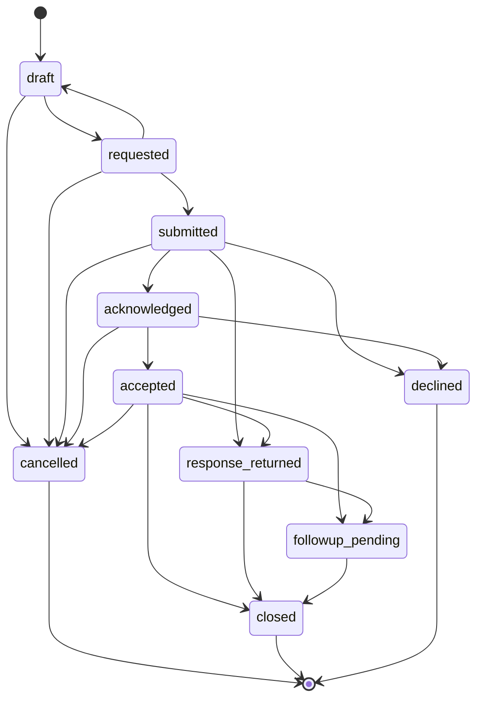

## Referral status state machine (`services/central/app/referrals/state.py`)

Enforced on the server by `transition()`: any move not listed raises `409 invalid_transition`. Each transition writes a `referral_events` row and an audit event, and updates the working-set expiry.

| Status | Label | Allowed next statuses |
|---|---|---|
| `draft` | Draft (doctor) | `cancelled`, `requested` |
| `requested` | In progress | `cancelled`, `draft`, `submitted` |
| `submitted` | Sent | `acknowledged`, `cancelled`, `declined`, `response_returned` |
| `acknowledged` | Acknowledged | `accepted`, `cancelled`, `declined` |
| `accepted` | Accepted | `cancelled`, `closed`, `followup_pending`, `response_returned` |
| `response_returned` | Response received | `closed`, `followup_pending` |
| `followup_pending` | Follow-up | `closed` |
| `closed` | Closed | (final) |
| `declined` | Declined | (final) |
| `cancelled` | Cancelled | (final) |

Status groups: **PRE_SUBMISSION** = `draft`, `requested`; **IN_FLIGHT** = `accepted`, `acknowledged`, `submitted`; **CLINICAL_LOCKED** = `cancelled`, `closed`, `declined`, `followup_pending`, `response_returned`; **TERMINAL** = `cancelled`, `closed`, `declined`

### Other status fields (from the model column comments)

| Database | Column | Values | Default |
|---|---|---|---|
| central | `consents.status` | requested \| granted \| declined \| revoked \| expired \| withdrawn | `'requested'` |
| central | `record_requests.status` | sent \| answered \| partial \| refused \| pending_manual_review \| no_records \| unavailable \| failed |  |
| central | `encrypted_batches.origin` | custodian (a source institution's answer) \| doctor (the referring doctor's own items) \| patient (patient's scans) \| receiving (records the receiving hospital added) |  |
| central | `encrypted_items.kind` | lab \| imaging \| note \| prescription \| scan \| other |  |
| central | `documents.status` | uploaded \| queued \| processing \| extracted \| failed | `'uploaded'` |
| central | `evidence_items.origin` | source \| document \| manual |  |
| central | `evidence_items.review_state` | imported \| proposed \| corrected \| unresolved \| excluded \| manual |  |
| central | `evidence_items.verification_status` | source_record \| unverified \| verified \| invalidated |  |
| central | `evidence_items.selection_source` | default \| ai \| staff |  |
| central | `jobs.status` | queued \| running \| completed \| failed | `'queued'` |
| central | `selection_runs.status` | completed \| unavailable (no model / API error) \| rejected (answer failed checks) \| nothing_to_review \| discarded (the working set was removed before the answer arrived) |  |
| central | `source_retrievals.status` | successful \| empty \| partial \| denied \| unavailable \| invalid \| skipped (not the most recent of its kind) |  |
| central | `patient_links.kind` | records = asking a place the patient visited for their records (it matches a record or says it has none); intake = sent with a referral or test order, so the receiver matches the patient or registers them as new | `'records'` |
| central | `patient_links.status` | requested \| verified \| rejected \| invalidated | `'requested'` |
| central | `evaluation_runs.status` | completed \| failed |  |
| central | `flag_reviews.decision` | reviewed \| ignore \| research | `'reviewed'` |
| central | `label_rules.kind` | drug_condition \| drug_procedure |  |
| central | `label_rules.status` | auto_extracted \| withdrawn | `'auto_extracted'` |
| central | `medication_entries.mapping_status` | mapped \| ambiguous \| unmapped \| staff_mapped |  |
| central | `medication_flags.kind` | confirmed (approved manual rule) \| interaction \| label_warning \| unrecognised_medicine \| interactions_not_checked \| procedure_not_checked \| records_incomplete |  |
| central | `medication_flags.status` | active \| superseded \| withdrawn | `'active'` |
| central | `medication_rules.status` | draft \| approved \| rejected \| retired \| superseded | `'draft'` |
| central | `medicine_names.kind` | generic \| brand \| register_brand \| register_ambiguous (DRAP) | `'generic'` |
| central | `medicine_names.status` | active \| retired | `'active'` |
| central | `suggestion_reviews.decision` | ignore \| research |  |
| central | `clarifications.status` | open \| answered | `'open'` |
| central | `diagnostic_requests.status` | draft (in the referral, not sent yet) \| requested \| accepted \| rejected \| scheduled \| done \| reported \| cancelled | `'draft'` |
| central | `followup_tasks.status` | open \| completed \| not_completed | `'open'` |
| central | `outbox.kind` | deliver_package \| deliver_order \| forward_result \| clarification_answer |  |
| central | `outbox.status` | pending \| sent \| failed | `'pending'` |
| central | `referrals.kind` | referral = to a doctor or department; test = a test or scan only (its orders carry the destinations) | `'referral'` |
| central | `referrals.procedure_status` | planned \| none \| unknown | `'unknown'` |
| central | `referrals.status` | Workflow | `'draft'` |
| institution | `cases.status` | received -> acknowledged (staff) -> assigned (staff) -> accepted \| declined (doctor) -> responded -> completed | `'received'` |
| institution | `consultation_responses.status` | draft \| returned | `'draft'` |
| institution | `doctor_keys.status` | pending (waits for an administrator) \| active \| revoked \| rejected | `'pending'` |
| institution | `info_requests.status` | open \| answered | `'open'` |
| institution | `medications.status` | active \| stopped \| completed |  |
| institution | `orders.status` | requested \| accepted \| rejected \| scheduled \| done \| reported | `'requested'` |
| institution | `record_requests.status` | answered \| partial \| refused \| pending_manual_review \| declined |  |
| institution | `sent_copies.kind` | package \| response |  |
