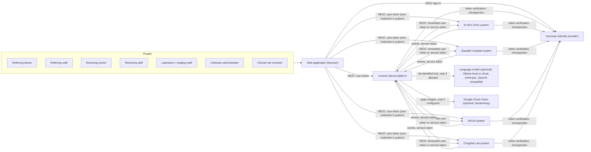
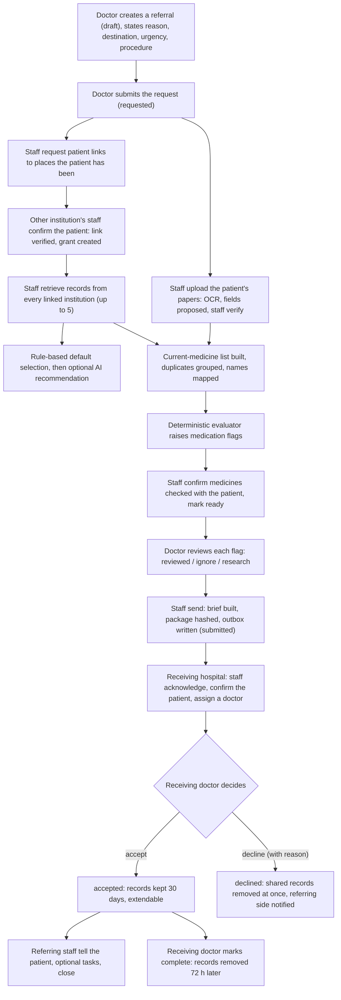

# 2. System overview

## 2.1 Context

Patients in Karachi are commonly treated at several unconnected places: a neighbourhood clinic, one or more hospitals, and a private laboratory. When a doctor refers a patient, the receiving specialist usually sees a short handwritten note. The patient's history at the other places, the current medicines and the results are missing. This platform assembles that information from the institutions that hold it, with each institution keeping control of its own records, and delivers it as a checked, versioned referral.

## 2.2 Actors and roles

| Actor | Realm role | What they do |
|---|---|---|
| Doctor | `clinician` | Requests referrals and test requests, reviews medication flags, receives referrals for their department, accepts or declines them, marks them complete, extends the records hold |
| Staff (referral coordinator) | `clinic_staff` | Requests and approves patient links, retrieves records, checks uploaded papers, confirms medicines (including over-the-counter), marks a referral ready, sends it, takes in incoming referrals and assigns a doctor, records that the patient was told, closes referrals |
| Laboratory, radiology or ECG staff | `diagnostics_staff` | Confirms arriving patients, accepts or rejects orders, schedules them, reports results with images |
| Institution administrator | `institution_admin` | Accounts and role templates, source access grants and their expiry, audit log. No clinical record access |
| Clinical rule reviewer | `rule_reviewer` | Approves medication rule versions and medicine names; sees the imported interaction data, label rules and AI model figures |
| Central platform service | `svc_central` | Machine identity: delivers packages, orders and copies; closes grants |
| Institution service | `svc_provider` | Machine identity: sends acknowledgement, decision, completion and order events to the platform |

A user's institution is their top-level Keycloak group, and their department is the subgroup (Appendix K).

## 2.3 Main capabilities

| Capability | Where it is built |
|---|---|
| Referral and test requests, status and timeline | `central/app/referrals`, `diagnostics` |
| Patient linking confirmed by the other institution | `central/app/identity`, institution `/identity/*`, `/sharing/grants` |
| Retrieval of history from every linked institution | `central/app/integration` |
| Uploaded papers: OCR and field extraction | `central/app/documents` |
| Evidence review: verify, correct, exclude, manual entry | `central/app/evidence_router.py` |
| Current-medicine list, name mapping (incl. DRAP brands) | `central/app/medications/service.py`, `mapping.py` |
| Deterministic medication flags | `central/app/medications/evaluator.py` |
| Packet selection (default, AI, staff) | `central/app/selection` |
| Referral letter (brief), package, hash, delivery | `central/app/sending`, `delivery` |
| Receiving side: intake, assignment, decision, completion | institution service `/cases/*` |
| Test and scan orders and reports | `central/app/diagnostics`, institution `/orders/*` |
| Follow-through: patient informed, tasks, closure | `central/app/followup` |
| Temporary working set and grant close-out | `central/app/lifecycle`, `integration/grant_closeout.py`, `tasks.py` |
| Notifications and work queue | `central/app/notifications.py`, `workqueue.py` |
| Audit | every service (`audit_events`) |

## 2.4 End-to-end flow (referral)

Test requests follow a shorter path: the doctor lists the tests, staff send each one as its own order, and the laboratory or imaging department accepts, schedules, performs and reports it. Results return to the referral (Section 7.10).
