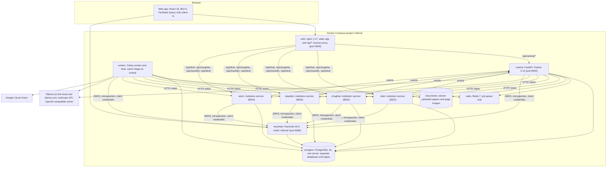
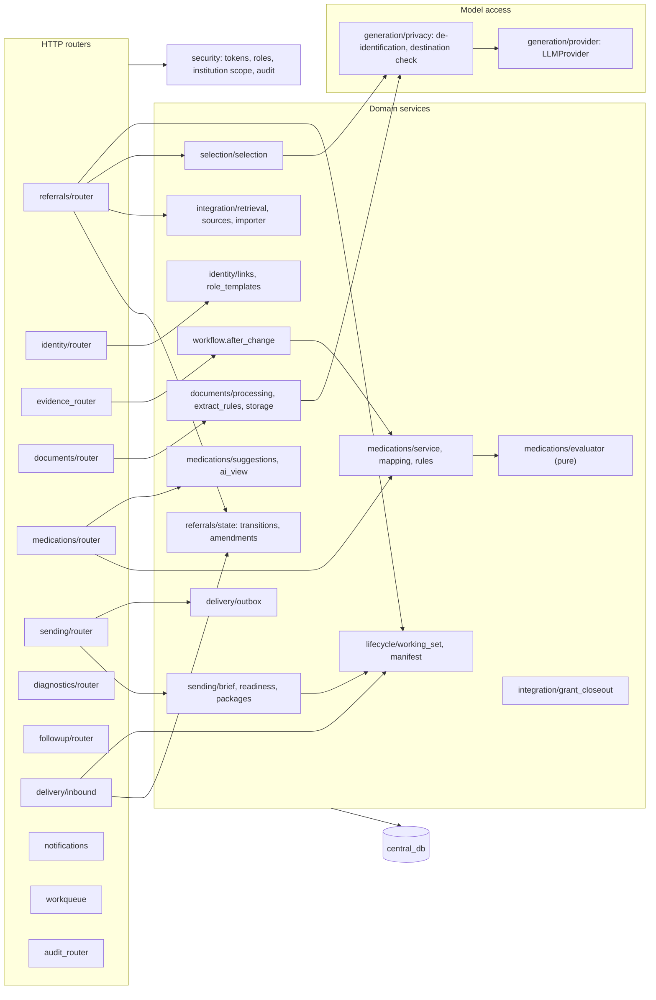

# 4. Architecture

> **Superseded in part by section 18 (spec v4, 2026-10-30).** Retrieval no longer copies plaintext records to the platform: institutions answer records requests with ciphertext under the patient's signed consent, and the doctor's device decrypts and signs the package (section 18.2 to 18.4).

## 4.1 Container view

| Container | Responsibility | Owns | Technology |
|---|---|---|---|
| `web` | Serves the single-page app; proxies `/api/central/*` to the platform and `/api/<institution>/*` to each institution's own system; security headers | Nothing | nginx 1.27 serving a Vite build (React 18, TypeScript 5.6, MUI 6) |
| `central` | Referral workflow API: requests, links, retrieval, evidence, documents, medicines, flags, selection, sending, inbound events, follow-up, notifications, work queue, audit | `central_db`, documents volume | FastAPI 0.115, SQLAlchemy 2.0, Alembic, pydantic 2, httpx, PyJWT |
| `worker` | Document processing, outbox delivery, AI selection, purges, retention, grant close-out | Nothing of its own (job state in `central_db`) | Celery 5.4 with beat, same image as `central` |
| `drali`, `chughtai`, `ziauddin`, `akuh` | One institution's own system: patient records, identity lookup and registration, access grants, FHIR record API, receiving referrals (cases), diagnostic orders, sent copies, outbox to the platform | `<institution>_db` | FastAPI; one image, `INSTITUTION_ID` selects the institution |
| `keycloak` | Accounts, roles, institution and department groups, OIDC tokens, introspection, admin API for role templates | `keycloak` database | Keycloak 26.0 |
| `postgres` | One server, separate databases and logins (`infra/postgres/init/01-databases.sh`) | — | PostgreSQL 16 |
| `redis` | Celery broker; never a source of truth | — | Redis 7 |

## 4.2 Component view: central platform

The platform is a modular monolith (`services/central/app`). `main.py` mounts one router per feature module. Modules talk to each other through plain function calls in the same transaction, never through HTTP.

| Module | Responsibility |
|---|---|
| `referrals` | Create, edit, submit and cancel requests; patient search; links for a referral; retrieval trigger; AI recommendation trigger; event timeline. `state.py` holds the status machine and amendment rule. |
| `identity` | Patient-link requests, lookup, approval (creates the target's grant), rejection, invalidation; account administration (disable, enable, apply role template); institutions list. |
| `integration` | Calls to institution APIs with the user's token (`sources.py`); retrieval across linked institutions (`retrieval.py`); FHIR to evidence mapping (`importer.py`); grant close-out (`grant_closeout.py`). |
| `evidence_router` | Record and paper-field review: select, verify, correct, unresolve, exclude, restore, manual entry. Every change is an `evidence_revisions` row. |
| `documents` | Upload with type and size checks, protected storage, OCR (Tesseract or Google Vision), field extraction (language model or rules), page images. |
| `medications` | Current-medicine list and duplicate grouping (`service.py`), name mapping including DRAP brands (`mapping.py`), rule versions and approval (`rules.py`), the pure evaluator (`evaluator.py`), label-rule validation, AI suggestions. |
| `selection` | Rule-based default packet selection, AI recommendation (validated), staff decisions, selection snapshot for the package. |
| `sending` | Readiness checklist, brief (letter), package building and hashing, sending, retry, package verification. |
| `delivery` | Outbox delivery to institutions (`outbox.py`); inbound events from institutions, deduplicated (`inbound.py`). |
| `diagnostics` | Test and scan requests: draft, send as orders, track order events, results and attachments. |
| `followup` | Clarification answers, patient informed, follow-up tasks, closure; legacy response review. |
| `lifecycle` | Working-set expiry rules and purge (`working_set.py`); package manifest and purged envelope (`manifest.py`). |
| `generation` | `LLMProvider` with Anthropic, Ollama and OpenAI-compatible implementations and schema checking; privacy gate and de-identification. |
| `notifications`, `workqueue` | Notifications to a user or a role at an institution; role-based work queue. |
| `security` | Principal resolution, account status check, role and institution checks, audit helpers, optimistic concurrency. |
| `tasks` | Celery app, beat schedule, job execution with permission re-check (Appendix I). |
| `seed` | Loads medicine names, rules, ingredients, DDInter subset, label rules and seeded links. |

## 4.3 Component view: institution service

The same code (`services/provider/app`) runs once per institution. `INSTITUTION_ID` selects which one, and each instance has its own database and Keycloak client.

| Part | Responsibility |
|---|---|
| Patient records | `patients`, `conditions`, `surgeries`, `visits`, `medications`, `lab_results`, `imaging_reports`, all versioned (`Versioned` mixin) |
| Access decisions | `refcommon.sourcekit.decide_access`: own institution by role category, or another institution with a live grant (Section 8.3) |
| Identity | `/patients` index, `/identity/lookup` (field-by-field comparison for a person to judge), `/identity/register` (new patient), `/intake/patient` |
| Record API | `/fhir/patients/{id}/records` (FHIR searchset Bundle of the referral profile), `/patients/{id}/activity` (last seen) |
| Grants | `/sharing/grants` (created on link approval), `/admin/grants*` (administrator: list, create, extend, revoke), `/grants/revoke-by-referral` (platform service only) |
| Receiving referrals | `cases` and `incoming_packages`: acknowledge, assign, decide, information requests, complete, extend hold, legacy response; `/inbound/referral-expired` removes the shared copy |
| Diagnostic orders | `orders`, `order_attachments`: accept, reject, schedule, done, report with images |
| Sender's copies | `sent_copies` via `/outbound-copies` |
| Outbox | Events to the platform (`POST /inbound/provider-events`), retried with the same event key |
| Adapter | Local rows to FHIR resources; incoming envelopes to local rows (`adapter.py`) |

## 4.4 Shared library (`libs/common/refcommon`)

| Module | Contents |
|---|---|
| `auth.py` | `Principal`, `KeycloakConfig`, `TokenVerifier` (signature, issuer, audience, introspection cached 10 s), `ServiceTokenProvider` (client credentials), FastAPI principal dependency |
| `sourcekit.py` | Access categories by role, `decide_access`, grant lifecycle (`grant_state`, `grant_expiry`, default 14 and maximum 30 days), audit and grant mixins, shared routers (health, admin grants, grant close-out), FHIR records bundle |
| `exchange.py` | Versioned envelopes: `PackageEnvelope`, `DiagnosticOrder`, `ResultForward`, `ProviderEvent`, `ClarificationAnswer`, canonical hashing (Appendix G) |
| `fhir.py` | Builders for the pinned FHIR R4 subset (Bundle, OperationOutcome and resources) |
| `db.py` | Session factory, `utcnow`, FastAPI session dependency |

## 4.5 Web application

The single-page app (`web/src`) authenticates with Keycloak using authorization code with PKCE (public client `referral-web`, `oidc-client-ts`). It calls the platform at `/api/central/*`. Institution staff also use their own institution's system directly at `/api/<institution>/*` for incoming cases and orders, with the same user token. The routes, feature modules and role-based menus are listed in Appendix K.

| Area | Screens |
|---|---|
| Work | Work queue, requests sent, new referral, referral workspace (Request, Links, Records, Papers, Medicines, Tests, Send, Response, Audit tabs), document review, records requests, incoming referrals and case view, test and scan orders |
| Rules (reviewer) | Medication rules (manual rules, interactions, label rules, AI figures), medicine names |
| Administration | Accounts and role templates, source access (grants), audit log |
| Public | Sign-in, privacy notice, terms of use, accessibility statement |

The menu comes from the role templates (`GET /me`). Hiding a screen is a convenience only: every API call is checked on the server.

## 4.6 Technology stack

| Layer | Choice | Reason |
|---|---|---|
| Backend | Python 3.12, FastAPI, pydantic 2, SQLAlchemy 2.0, Alembic | Typed request validation, OpenAPI for free, mature ORM and migrations |
| Background work | Celery 5.4 with beat, Redis 7 | Retries, schedules, separation of slow work (OCR, AI) from requests |
| Database | PostgreSQL 16 | JSON columns for FHIR and envelopes, transactions for the outbox |
| Identity | Keycloak 26 (OIDC, PKCE, client credentials, introspection, admin API) | Standard protocols, groups for institutions and departments, immediate revocation |
| OCR | Tesseract 5 (pytesseract, pypdfium2, Pillow); optional Google Cloud Vision | Offline by default; handwriting when allowed |
| Language model | Behind `LLMProvider`: Ollama (local or `:cloud`, e.g. `gemma4:cloud`), Anthropic, OpenAI-compatible | Replaceable; optional; privacy-gated |
| Frontend | React 18, TypeScript 5.6, MUI 6, TanStack Query 5, React Router 6, react-hook-form, oidc-client-ts 3, Vite 6 | Accessible components, caching and polling |
| Testing | pytest (unit and integration), Playwright (browser) | Section 15 |
| Delivery | Docker Compose; Caddy 2 for HTTPS in production; GitHub Actions CI | Section 14 |
