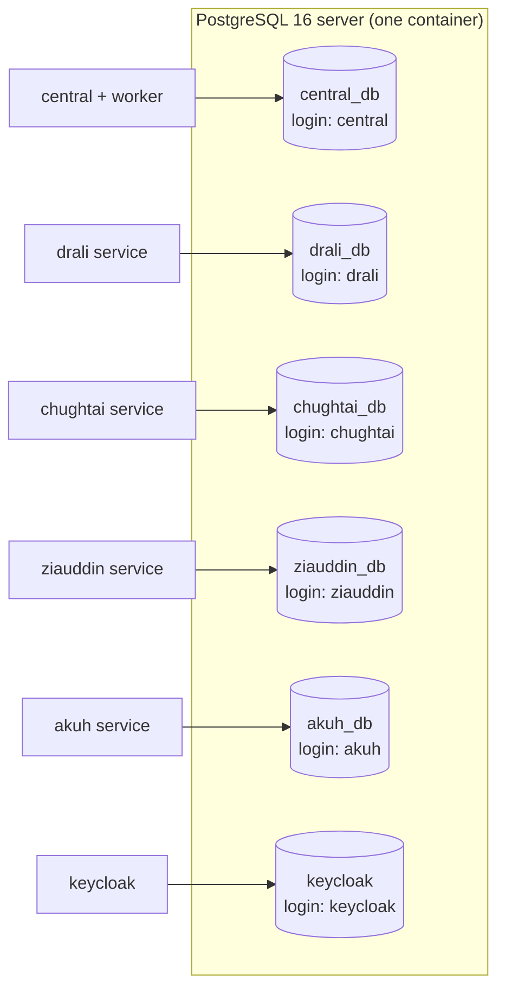
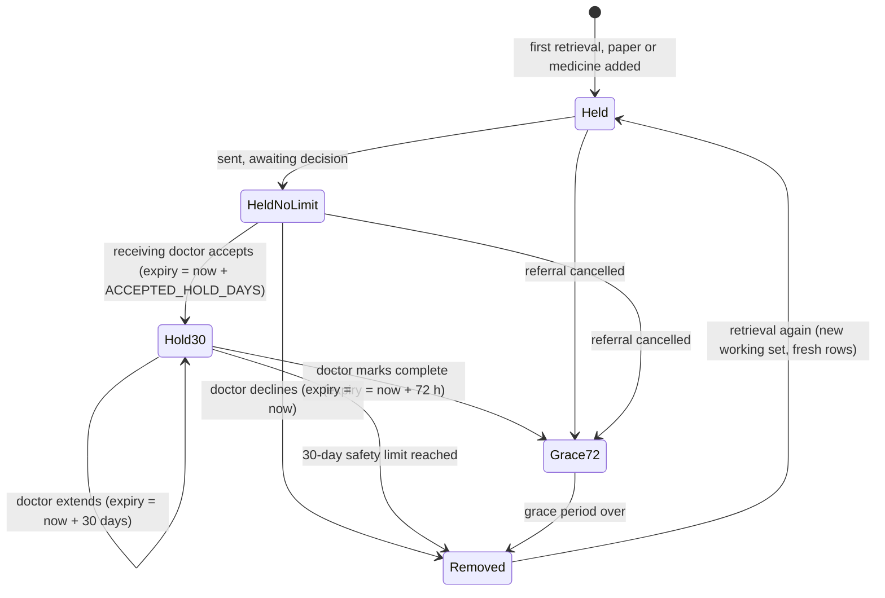

# 5. Data architecture

> **Superseded in part by section 18 (spec v4, 2026-10-30).** Retrieved records are no longer stored as plaintext `evidence_items`: the platform keeps `encrypted_batches`, `encrypted_items`, `wrapped_keys`, `package_manifests` and `purge_receipts` (section 18.1, 18.8). The sender's copy and the receiver's stored package were removed.

## 5.1 Databases and ownership

`infra/postgres/init/01-databases.sh` creates each database with its own login on first start. Each service receives only its own connection string. Redis holds only Celery messages. Uploaded papers and page images are files in the `documents` volume, under generated names outside any web root, served only through authenticated endpoints (`documents/storage.py`).

| Database | Tables (exact list: Appendices A, B) | Content |
|---|---|---|
| `central_db` | about 34 | Users (references to Keycloak accounts), patient links, referrals and their timeline, evidence, documents and extraction, packet selection runs, medicine list, medicine names, ingredients, interaction and label rules, manual rule versions, evaluation runs, flags and reviews, AI suggestions, briefs, packages, outbox, inbound messages, clarifications, responses, tasks, diagnostic requests, notifications, jobs, audit |
| `<institution>_db` (×4) | about 18 | The institution's own patient records, access grants, audit, received referrals (cases, packages, information requests, responses, forwarded results), diagnostic orders and attachments, sent copies, outbox |
| `keycloak` | Keycloak's own | Accounts, credentials, sessions, realm configuration |

The complete ERDs are in Appendices A and B, the column-level data dictionary in Appendices D and E, and the identifiers that cross service boundaries in Appendix C.

## 5.2 Central data model by domain

```mermaid
flowchart TB
    subgraph Referral["Referral workflow (models/referrals.py)"]
        R["referrals"] --- RE["referral_events"]
        R --- BRF["briefs"] --- PK["referral_packages"]
        R --- OB["outbox"]
        R --- IM["inbound_messages"]
        R --- CL["clarifications"]
        R --- CR["consultation_responses"]
        R --- FT["followup_tasks"]
        R --- DR["diagnostic_requests"]
        R --- NT["notifications"]
    end
    subgraph Evidence["Evidence and documents (models/evidence.py)"]
        SR["source_retrievals"]
        EI["evidence_items"] --- ER["evidence_revisions"]
        DOC["documents"] --- XR["extraction_runs"]
        JB["jobs"]
        SL["selection_runs"]
    end
    subgraph Meds["Medicines (models/medications.py)"]
        ME["medication_entries"]
        MN["medicine_names"]
        ING["ingredients"]
        DI["drug_interactions"]
        LR["label_rules"]
        MR["medication_rules"]
        RR["ruleset_releases"]
        EVR["evaluation_runs"] --- MF["medication_flags"] --- FR["flag_reviews"]
        AS["ai_suggestions"] --- SRV["suggestion_reviews"]
    end
    subgraph Identity["Identity and audit (models/identity.py, audit.py)"]
        U["users"]
        PL["patient_links"] --- PLE["patient_link_events"]
        AE["audit_events"]
    end
    R --- SR & EI & DOC & JB & SL & ME & EVR & FR & SRV
    EI --- ME
    PL -.-> EI
```

**Reference data versus referral data.** `medicine_names`, `ingredients`, `drug_interactions`, `label_rules`, `medication_rules`, `ruleset_releases` and `ai_suggestions` are reference data, loaded by the seed or maintained by the clinical reviewer. They are not tied to a referral. Everything else hangs off `referrals` and forms the working set (Section 5.5).

## 5.3 Identifiers and keys

| Identifier | Format | Where it is made |
|---|---|---|
| Referral reference | `REF-<year>-<id:05>` (referral) or `TST-<year>-<id:05>` (test request) | `referrals/router.py` on creation |
| Diagnostic request reference | `DX-<year>-<id:05>` | `referrals/router.py` |
| Institution patient ID | Institution prefix and number, e.g. `DA…`, `ZH…`, `AK…`, `MD…` (`LOCAL_ID_PREFIX`) | Institution service |
| Package delivery key | `<source institution>:<referral reference>:v<version>` | `sending/packages.py` |
| Sender copy key | `copy:<delivery key>` or `copy:<event key>` | `sending/packages.py`, `delivery/inbound.py` |
| Order key | `<source institution>:<DX reference>` | `diagnostics/router.py` |
| Provider event key | Unique per event, chosen by the institution service | Institution outbox |
| Flag key | `rule:<rule_id>:<ingredient>`, `ddi:<a>:<b>`, label rule key, `unrecognised:<entry>`, `procedure:<ingredient>`, `interactions_not_checked`, `records_incomplete` | `medications/evaluator.py` |
| Evidence source key | (referral, source institution, record type, record id, record version), unique | `uq_evidence_source_version` |
| User id | Keycloak subject (`sub`) | Keycloak |

## 5.4 Versioning and history patterns

| Pattern | Used for | How |
|---|---|---|
| Optimistic concurrency | `referrals`, `evidence_items`, institution `consultation_responses` | `row_version` column. Clients send `expected_row_version`; a stale value gets `409 stale_version` (`security.check_version`). |
| Append-only revisions | Evidence corrections, verification and exclusion | `evidence_revisions` (prior and new value, state, editor, note). Raw extraction is never overwritten (invariant 8). |
| Source record versions | Retrieved records | Each FHIR resource's `meta.versionId` is stored. A newer version creates a new evidence row and supersedes the old one (`superseded_by`); a staff selection carries over. |
| Flag versions | Medication flags | A material change supersedes the flag row and inserts version + 1. Reviews refer to a specific flag version. |
| Rule versions | Manual medication rules | Each edit is a new draft version. Only an approved version raises flags; approving a newer version supersedes the older. |
| Immutable packages | Sent versions | `referral_packages` rows are never updated except the supersession marker and the purge. The SHA-256 covers every clinical field. |
| Amendments | Clinical change after sending | `mark_clinical_change()` sets `amendment_open`; a new version must be sent and the sent one stays untouched. |
| Record versions at institutions | Patient records | `Versioned` mixin: `version` and `updated_at` on every record table. |

## 5.5 Data lifecycle

"Shared records" means a referral's working set: retrieved records, papers and their text, the medicine list, flags, the letter and the sent package content. They exist on the platform and in the receiving hospital's copy. The rules are in `lifecycle/working_set.py` (decision 2026-10-28, referral expiry).

| Event | Shared records |
|---|---|
| Sent, not yet accepted | Kept, no time limit |
| Receiving doctor accepts | Kept until 30 days after acceptance (`ACCEPTED_HOLD_DAYS`) |
| Receiving doctor extends (reason required, any number of times) | Limit reset to 30 days from then, never shorter |
| Receiving doctor marks complete (never automatic) | Removed 72 hours later (`WORKING_SET_GRACE_HOURS`) |
| Receiving doctor declines | Removed straight away (the worker purge is queued at once) |
| Referring side cancels | Removed 72 hours later |
| Test request | Removed 72 hours after all results are back, or after closing or cancelling |

**What the purge does** (`purge_working_sets`, every 10 minutes, `lifecycle/working_set.py::purge`):

- **Evidence:** display and values are replaced with `[removed: working set ended]`, and the FHIR copy, source text, regions, confidence and AI reason are cleared. The row keeps its id, category and the purged record version. It drops out of every list.
- **Papers:** the files and page images are deleted, and the extracted text is replaced with a marker.
- **Medicine list, flags, reviews, letter, responses, clarifications, results, outbox and inbound payloads:** text cleared. Flags become `purged`.
- **Packages:** the envelope is replaced by a purged envelope (identifiers and hash). The `manifest` (what it contained, by source record and version, flags and rule set) and the SHA-256 stay.
- **At the receiving hospital:** the platform sends `expire_shared` (`POST /inbound/referral-expired`). The hospital removes its copy of the packages and forwarded results, and keeps its own decision, questions and response.

**What the purge waits for:** content is never removed while a package, order or the sender's copy is not yet confirmed delivered, or before the sending clinic has confirmed its own copy of each sent package (`blockers()`). A deferred purge is audited with its reasons.

**What always stays:** referral identifiers and status, the event timeline, audit events, patient links, users, selection-run metadata (no record values), package manifests and fingerprints.

**After removal:** screens say the records are "no longer held", never "none" (invariant 7). `POST /referrals/{id}/packages/{v}/verify-own-copy` checks the sending clinic's lasting copy against the kept hash.

**Other retention:**

- **Uploaded papers of closed referrals:** deleted after `DOCUMENT_RETENTION_DAYS` (365) by `retention_sweep`, if still present.
- **Access grants:** expire after 14 days by default (30 at most). They are also revoked by `close_referral_grants` when a referral reaches a final status.
- **Audit:** append-only, never purged.

## 5.6 Record exchange format (FHIR R4 4.0.1 subset)

Institutions return a FHIR `searchset` Bundle from `GET /fhir/patients/{id}/records?since=…&categories=…`, built by `services/provider/app/adapter.py`:

| Category | FHIR resource | Date limit |
|---|---|---|
| demographics | Patient | — |
| conditions | Condition (SNOMED CT where known, clinical status, onset) | none: all non-error conditions |
| surgeries | Procedure | none |
| visits | Encounter (setting, reason, narrative summary, participant) | since the specialty's history window |
| medications | MedicationRequest (original name, dosage text, route, timing; active only) | none: active only |
| labs | Observation (LOINC, value and unit as recorded, reference range); latest result per test | since the window |
| imaging | DiagnosticReport (study, findings, impression) | since the window |

Every resource carries `meta.versionId` (the source record version) and `meta.source`. Withheld categories are reported in an `OperationOutcome` entry, so the platform shows a **partial** result instead of silently missing data. The central importer (`integration/importer.py`) validates each resource, keeps original values, units, codes and dates in `original`, and counts invalid resources instead of dropping them. The referral package carries a `collection` Bundle with a `ServiceRequest` for the referral. Responses use a `Task`. Workflow messages travel in project envelopes (Appendix G), never inside FHIR resources.
