# 7. Key workflows

Each diagram shows the calls that happen in the code. Names in `code` are the endpoints or functions involved. Every request carries a Keycloak access token that the receiving service verifies (Section 8.1); the diagrams omit this for brevity.

## 7.1 Sign-in and request authentication

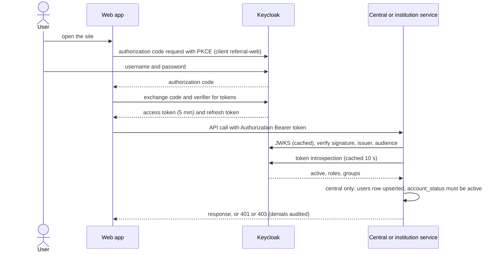

## 7.2 Patient link confirmation and access grant

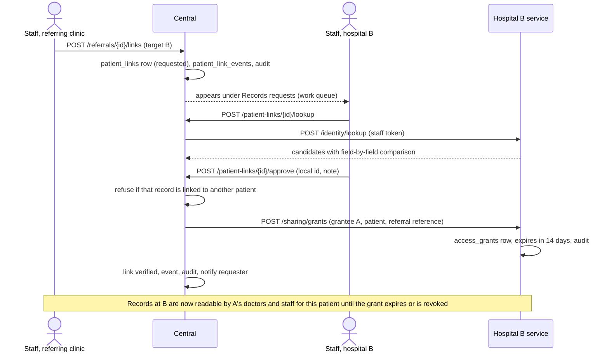

## 7.3 Retrieval across linked institutions

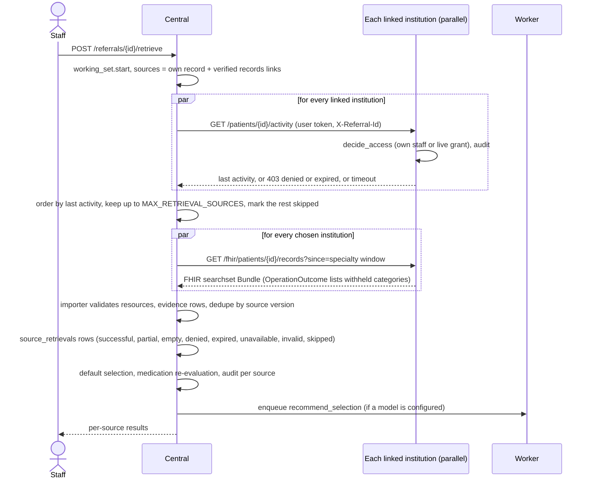

## 7.4 AI packet recommendation

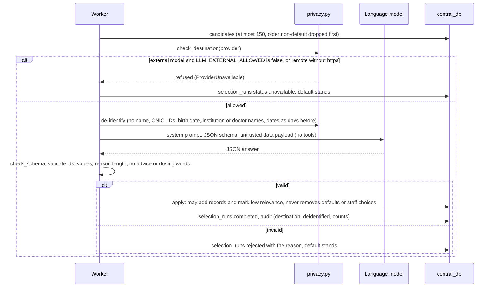

## 7.5 Uploaded paper: OCR and field review

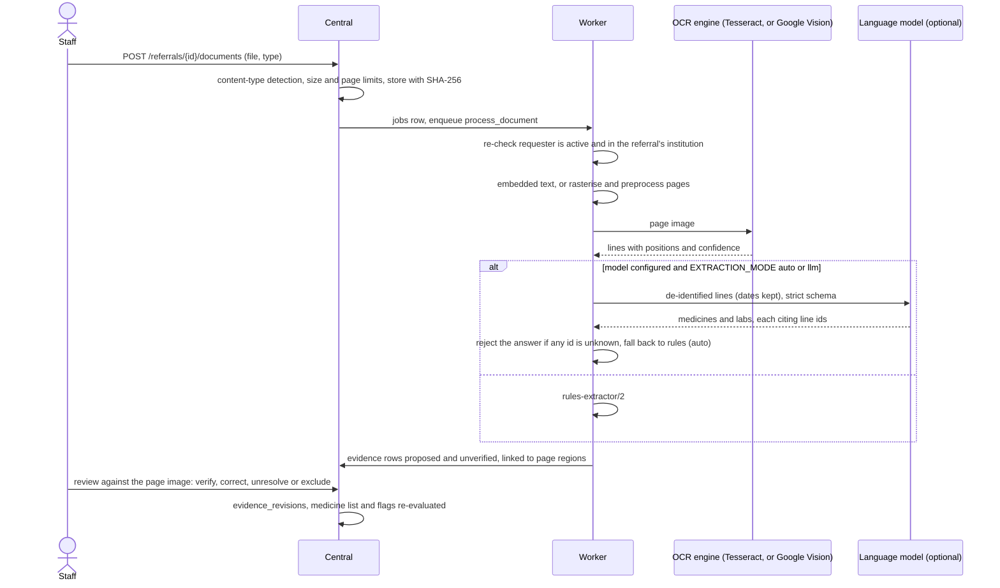

## 7.6 Medicines, flags and the doctor's review

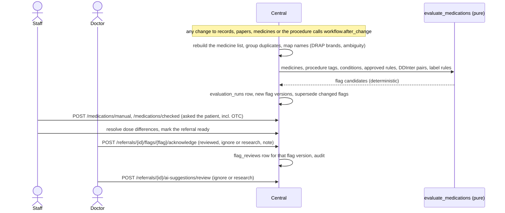

## 7.7 Sending a version and delivery

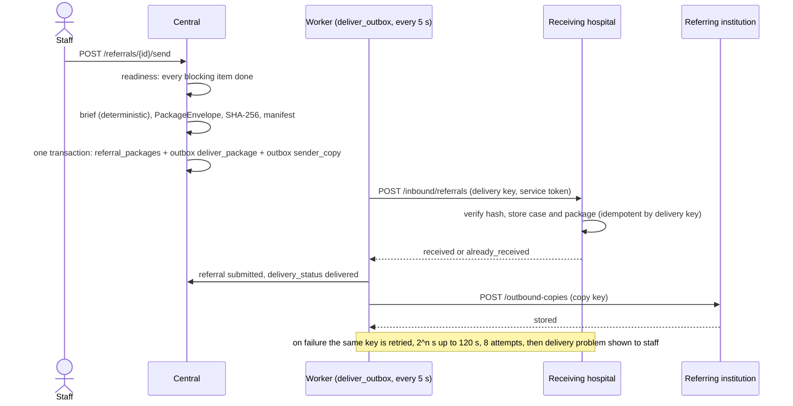

## 7.8 Receiving side: intake, decision, completion and expiry

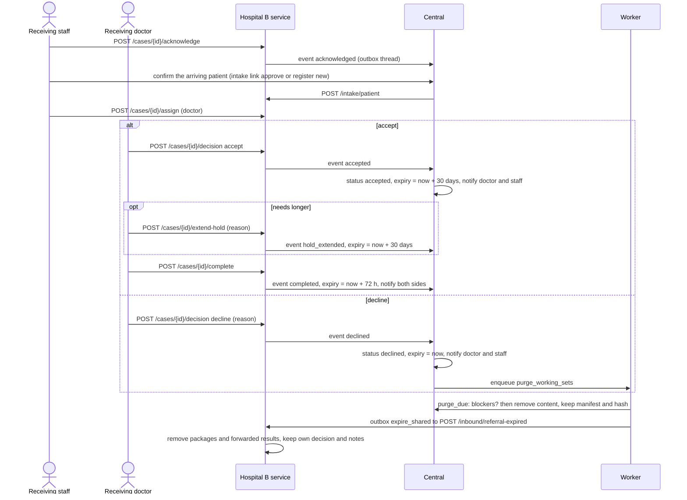

## 7.9 Referring side follow-through

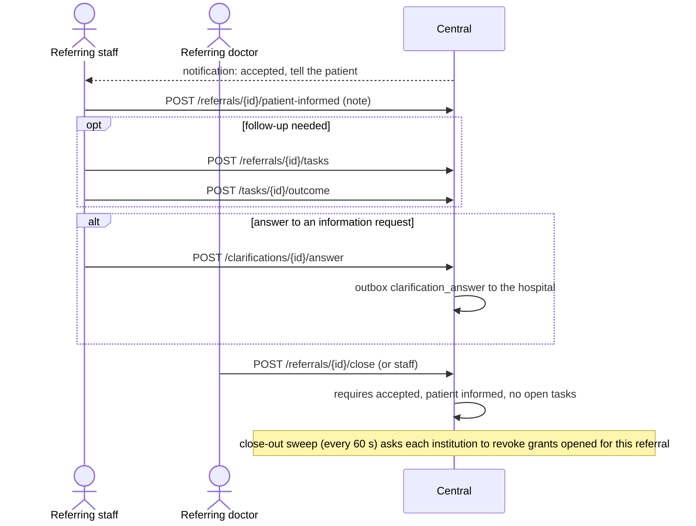

## 7.10 Test and scan request

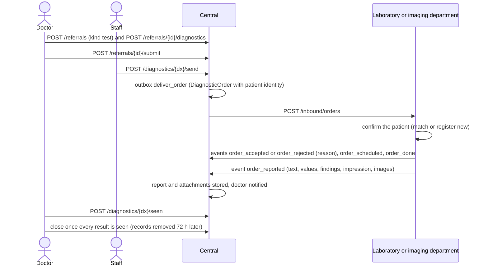

## 7.11 Account disabling and grant close-out

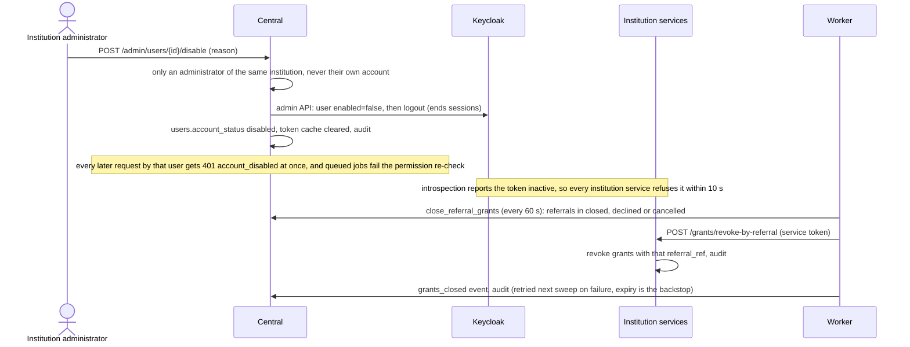
