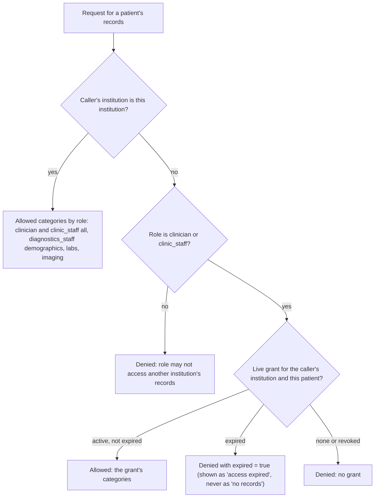

# 8. Security architecture

## 8.1 Authentication

| Party | Mechanism |
|---|---|
| People (browser) | OIDC authorization code with PKCE. Public client `referral-web`, library `oidc-client-ts`. Access tokens last 5 minutes, sessions go idle after 30 minutes and last at most 10 hours. Brute-force protection is on in the realm. |
| Integration tests and scripts | Public client `dev-cli` with the password grant. For local development only; it must be removed or disabled for a hosted deployment. |
| Services | Confidential clients with client credentials: `central-api` (role `svc_central`) and `drali-api`, `chughtai-api`, `ziauddin-api`, `akuh-api` (role `svc_provider`). `ServiceTokenProvider` fetches and caches the token. |

**Verification at every service** (`refcommon.auth.TokenVerifier`):

1. The JWT signature is checked against Keycloak's JWKS (keys cached).
2. The issuer must be the realm, by its public or internal URL.
3. The audience must be the service's own client.
4. The token is introspected with Keycloak, using the service's client credentials, and the result is cached for 10 seconds. So a disabled account or ended session stops working within seconds, before the token expires.

Identity comes only from the verified token: never from request headers or the request body (invariant 2). The `Principal` carries the subject, username, display name, institution (top-level group), department (subgroup), roles and the raw token for forwarding.

**Central only.** `security.get_principal` creates or updates the `users` row on each request and rejects an account whose `account_status` is not `active` (`401 account_disabled`). The rejection is audited.

## 8.2 Authorisation on the central platform

| Rule | Enforcement |
|---|---|
| A referral is visible and changeable only by its own institution's doctors and staff | `security.load_referral`: caller's institution must equal `referral.source_institution`, and the role must be in the allowed set (default `clinician`, `clinic_staff`). Every denial is audited and returns 403. |
| Doctor-only actions: create a request (`POST /referrals`), decide on a medication flag | `require_roles(principal, "clinician")`; `load_referral(..., roles=("clinician",))` |
| Preparation actions: links, retrieval, papers, evidence review, medicines, submit, send, patient informed, close | `load_referral` with the default roles: **both** `clinician` and `clinic_staff` of the referring institution may call them. The order of work (staff prepare, the doctor reviews flags, staff send) comes from the readiness checklist and the screens, not from separate role checks. |
| Patient-link decisions | `clinic_staff`, `institution_admin` or `diagnostics_staff` of the target institution |
| Administrators manage accounts, grants and audit; no clinical record access | `institution_admin` checks; `load_referral` does not accept it |
| Rule and medicine-name approval | `rule_reviewer` only |
| Service-to-service endpoints | `require_service(principal, "svc_provider")` plus the event's institution must match the caller's institution |
| Concurrent edits | `check_version` (`409 stale_version`) |
| Background jobs | `_start()` re-checks that the requester is still active and still in the referral's institution before running |

The per-endpoint checks are generated in Appendix F. The web menu only hides screens; it is not an enforcement point.

## 8.3 Authorisation at institutions (source access)

`refcommon.sourcekit.decide_access(db, grant_model, principal, own_institution, patient, requested_categories)` returns the allowed and denied categories:

**Grants:**

- **Creation:** only the institution's own staff (on link approval) or its administrator can create one. The platform cannot create or bypass a grant.
- **Duration:** default 14 days (`DEFAULT_GRANT_DAYS`), maximum 30 (`MAX_GRANT_DAYS`). Only the institution's administrator can extend.
- **Closing:** revoked when the referral reaches a final status (`/grants/revoke-by-referral`, platform service only).
- **Legacy grants** without an expiry are reported so an administrator can renew or revoke them.

Every decision is audited in the institution's own `audit_events`, with the referral context from `X-Referral-Id`.

## 8.4 Audit

Every database has an `audit_events` table with actor id and name, institution, action, target type and id, outcome (`success`, `denied`, `partial`, `deferred`, …), detail (JSON, no clinical content) and time. Centrally it also records the referral id; institutions record the referral context.

**Audited events:**

- every access and denial;
- retrieval per source;
- link requests, decisions and invalidations;
- evidence changes;
- flag and suggestion decisions;
- rule approvals;
- sends and deliveries;
- inbound events and status changes;
- AI calls: destination, de-identified, counts, model and prompt version, never content;
- purges and deferrals;
- grant creation, extension and revocation;
- account and role changes.

Denials that abort a request are written in a separate transaction (`audit_now`) so they are not rolled back. Audit rows are never purged. Administrators see their institution's audit metadata (`GET /admin/audit`), and doctors and staff see a referral's audit tab (`GET /referrals/{id}/audit`).

## 8.5 Data protection

| Concern | Measure |
|---|---|
| Separation | Separate database and login per owner. The platform has no institution credentials (invariant 1). |
| Minimisation | The referral profile returns only referral-relevant categories within the specialty window, the latest result per lab test, and active medicines only. Packet selection limits what is sent. |
| Temporary central storage | Working-set purge, at receiving hospitals too (Section 5.5). |
| Files | Uploaded papers are stored outside any web root under generated names, checked by content type, size and page count, served only after a referral access check. |
| Transport | Locally, HTTP inside the Docker network. Production: Caddy terminates TLS with Let's Encrypt and HSTS; only ports 80 and 443 are exposed and all services are reachable only inside the network (`docker-compose.prod.yml`). Remote model servers must use https. |
| Web hardening | nginx sets `X-Content-Type-Options: nosniff`, `Referrer-Policy: same-origin` and `X-Frame-Options: DENY`; the upload limit is 12 MB. Caddy removes the `Server` header. |
| Secrets | Only in `.env` (git-ignored). `.env.example` holds placeholders. Keys are sent in headers, never URLs. No secrets in the SDS (Appendix J hides them). |
| Synthetic data | All seed data is fictional (`patients.synthetic = true`). Committing real patient data, credentials, model weights or uploads is forbidden (invariant 11). |
| At rest | PostgreSQL and the documents volume are not encrypted by the application. A hosted deployment must use encrypted disks (Section 16). |

## 8.6 Language-model privacy

Every call to a model goes through `generation/privacy.py` (decision 2026-10-28, cloud-model privacy):

- **Destination check:** a model that runs outside this computer is used only when `LLM_EXTERNAL_ALLOWED=true`. That covers any Ollama `:cloud` model (even through a local Ollama), ollama.com, Anthropic and any remote server. Otherwise the call is refused before anything is sent. Remote servers must use https.
- **De-identification, always:**
  - Never sent: name, CNIC, record numbers, date of birth or the referral reference.
  - Removed from the text: name parts, long numbers (ID and phone), doctors' names (`Dr …`) and institution names.
  - Calendar dates become "N days before the referral". Paper reading keeps dates, because a medicine's start date is a field.
  - The model receives age, sex, the reason, the department, the procedure, and each record's category and text.
- **Minimum necessary:** at most 150 records, 300 characters each.
- **No logging of content:** the audit records the destination, `deidentified: true`, the model and counts.
- **No tools:** the model can only return the fixed JSON schema. Record text is labelled as untrusted data.

Google Cloud Vision receives page images, which cannot be de-identified. It is used only when `OCR_ENGINE=google_vision`, and only with synthetic papers until the operating institution agrees (decision 2026-10-28, handwriting OCR).

## 8.7 Threat model (STRIDE summary)

| Threat | Example | Mitigation |
|---|---|---|
| Spoofing | Forged identity header; another institution's service sending events | Token-only identity; audience per service; introspection; event institution must match the service identity |
| Tampering | Package changed after sending; record edited in place | SHA-256 over the hashed fields, re-checked by the receiver and on verification; immutable packages; append-only revisions |
| Repudiation | "I did not approve that" | Audit with actor, institution, time and outcome; flag decisions bound to the flag version and rule-set hash |
| Information disclosure | Reading another institution's records; over-sharing to a model | Source-side `decide_access` with expiring grants; institution scoping in `load_referral`; working-set purge; de-identification and the external-model switch |
| Denial of service | Slow or failing institution | Timeouts, bounded retries, parallel calls, partial results; outbox decouples delivery |
| Elevation of privilege | Administrator reading records; staff approving rules | Role checks on the server; administrators excluded from clinical access; service roles never assignable from templates |
| Prompt injection | Text in a record that tells the model to do something | Record text passed as data; no tools; schema and id validation; model output cannot change flags or remove defaults |
| Duplicate side effects | Retry after a timeout delivers twice | Idempotency keys (delivery, copy, order, event, answer keys) with unique constraints |
