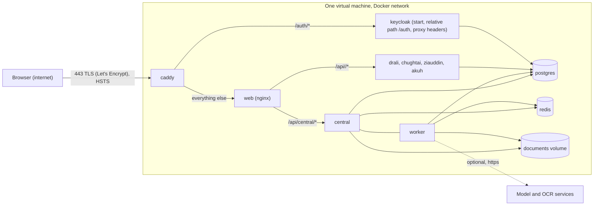

# 14. Deployment and operations

## 14.1 Environments

| Environment | How | Exposure |
|---|---|---|
| Local development | `docker compose up -d --build` (`docker-compose.yml`) | Web 3000, Keycloak 8080, central 8000, institutions 8001 to 8004 on localhost |
| Local with database tools | add `docker-compose.dbaccess.yml` | PostgreSQL on `127.0.0.1:5432` only; never on a shared server |
| Hosted (free tier) | `docker compose -f docker-compose.yml -f docker-compose.prod.yml up -d --build` with `SITE_HOST` (`docs/deploy-cloud.md`, Oracle Cloud Always Free) | Only Caddy on 80 and 443 with automatic HTTPS; website at `https://SITE_HOST/`, Keycloak at `https://SITE_HOST/auth`; every other port removed |
| CI | GitHub Actions (`.github/workflows/ci.yml`) | Ephemeral |

## 14.2 Deployment view (hosted)



In production, `KEYCLOAK_PUBLIC_URL` is `https://SITE_HOST/auth`, so token issuers match what the browser sees. Services still reach Keycloak internally at `http://keycloak:8080/auth`. The web image is built with `VITE_OIDC_AUTHORITY=https://SITE_HOST/auth/realms/referral`.

## 14.3 Configuration and secrets

- **Settings:** all come from environment variables. Appendix J lists every variable the code reads, with its default, and every Compose service's environment keys.
- **Installation:** copy `.env.example` to `.env` and set:
  - the database passwords (`*_DB_PASSWORD`) and the PostgreSQL superuser password;
  - the Keycloak administrator password;
  - every client secret (`*_CLIENT_SECRET`);
  - the demo user password.

  The Keycloak realm (`infra/keycloak/import/referral-realm.json`, generated by `scripts/make_keycloak_realm.py`) takes its client secrets from the environment **at first import**.

  Pitfall: an `.env` with missing secret names at first start produces empty client secrets in Keycloak, and the institution services then refuse every token because introspection is not configured. Fix it by setting the secrets and updating the Keycloak clients (or re-importing the realm).
- **Optional features:** `LLM_PROVIDER`, `LLM_MODEL`, `OLLAMA_HOST`, `LLM_EXTERNAL_ALLOWED`, `ANTHROPIC_API_KEY`, `LLM_BASE_URL`, `LLM_API_KEY`, `OCR_ENGINE`, `GOOGLE_VISION_API_KEY`.
- **Policy placeholders** (to be confirmed by the operating institution): `ACCEPTED_HOLD_DAYS` (30), `WORKING_SET_GRACE_HOURS` (72), `DEFAULT_GRANT_DAYS` (14), `MAX_GRANT_DAYS` (30), `REFERRAL_HISTORY_YEARS` (3), `REFERRAL_WINDOW_DAYS` (183), `MAX_RETRIEVAL_SOURCES` (5), `DOCUMENT_RETENTION_DAYS` (365), and `SPECIALTY_HISTORY_YEARS` (in code).

## 14.4 Database schema management

Each service runs `alembic upgrade head` on start (central: `services/central/migrations`; institution: `services/provider/migrations`). Appendix L lists the migration chains. New migrations are created by the module owner:

```
docker compose run --rm --no-deps -v ${PWD}/services/<svc>/migrations:/srv/migrations <svc> alembic revision --autogenerate -m "<what>"
```

## 14.5 Seeding and reset

`scripts/reset-and-seed.ps1 -Force` (or `.sh --force`) runs `python -m app.seed --reset --yes` in every institution service and in `central`. Each part is seeded as follows:

- **Institutions** load their own blocks of `seed-data/patients/*.json` (five fictional patients, P1 to P5).
- **The platform** loads the medicine names (including DRAP register brands), ingredients, the DDInter subset, label rules, seed manual rules, AI suggestions and the links each patient already has. The link to the destination hospital is not seeded; requesting it is part of the demo.

The seed version is `synthetic-seed/2.0`.

## 14.6 CI pipeline

| Job | Trigger | Steps |
|---|---|---|
| `web` | pull request, push to main | `npm ci`, `npm run typecheck`, `npm run build` |
| `backend-unit` | pull request, push to main | Build the central image; run `services/central/tests` (no paid model calls); `compileall` of services, libs and scripts |
| `images` | pull request, push to main | `docker compose build` with `.env.example` |
| `integration` | push to main | `docker compose up --wait`, reset and seed, `pytest tests` against the stack, logs on failure |
| `sds` | pull request, push to main | `python scripts/sds/build_sds.py check`: fails if the SDS is stale or the structure changed without a new SDS version (Section 17) |

## 14.7 Backup, restore and upgrades

- **Backup:** `scripts/backup.ps1` dumps every application database, the Keycloak database and the document storage, with a manifest (git commit, migration revisions, seed and rule versions).
- **Restore check:** `scripts/restore-check.ps1 -BackupDir <dir>` restores into a disposable network, database and volume, then verifies that the latest approved package and its documents reopen with matching SHA-256.
- **Upgrade:**
  1. Back up first.
  2. Deploy the new images; migrations run on start, and readiness must pass.
  3. Smoke test.
  4. Roll back images only when the schema is compatible; otherwise restore.

## 14.8 Monitoring

Each service exposes `/health` and `/ready`, and Compose restarts unhealthy containers. Operational signals live in the database:

- `outbox` rows that are failed or have many attempts;
- `jobs` rows that failed;
- `selection_runs` statuses;
- deferred purge audit events;
- `source_retrievals` statuses.

Delivery problems appear in the staff work queue. Logs carry request metadata, never clinical content or tokens.
